# Jungle House AI: Handover and Installation Guide

This guide is for the Jungle House team taking over the **Jungle House AI** system from the Swinburne Group 3 student team. You don't need any programming knowledge for Part 1.

| Part | Who it is for | What you will do |
|---|---|---|
| [Part 1: Take over the live website](#part-1-take-over-the-live-website) | The Jungle House owner or manager | Move the website, database and accounts into your company's own accounts, change every password and key, and check that everything still works. |
| [Part 2: Install the system on a computer](#part-2-install-the-system-on-a-computer) | A developer you hire later | Run a private copy on a Windows computer, change the code safely, and publish the change. |

> **Before you start:**
> - Take your time. Each step says **what you should see** when it worked.
> - If a screen looks different, the company that owns it (GitHub, Railway, Vercel, Google, Resend) may have moved a button since this guide was written in November 2026. Look for a button with a similar name, or follow the official help link given in that step.
> - Never send a password or key by WhatsApp or email. Store them in a password manager (for example Bitwarden or 1Password).

---

## Contents

- [0. The system in one picture](#0-the-system-in-one-picture)
- [Part 1: Take over the live website](#part-1-take-over-the-live-website)
  - [Step 1: Create your company accounts](#step-1-create-your-company-accounts)
  - [Step 2: Move the code (GitHub)](#step-2-move-the-code-github)
  - [Step 3: Move the backend and database (Railway)](#step-3-move-the-backend-and-database-railway)
  - [Step 4: Move the website (Vercel)](#step-4-move-the-website-vercel)
  - [Step 5: The web address (jhgroup3.com)](#step-5-the-web-address-jhgroup3com)
  - [Step 6: Replace every key and password](#step-6-replace-every-key-and-password)
  - [Step 7: Check that everything works](#step-7-check-that-everything-works)
  - [Step 8: Running the system day to day](#step-8-running-the-system-day-to-day)
- [Part 2: Install the system on a computer](#part-2-install-the-system-on-a-computer)
  - [Step 9: Install the tools](#step-9-install-the-tools)
  - [Step 10: Download the code](#step-10-download-the-code)
  - [Step 11: Set up a local database](#step-11-set-up-a-local-database)
  - [Step 12: Start the backend](#step-12-start-the-backend)
  - [Step 13: Start the website](#step-13-start-the-website)
  - [Step 14: Run the automatic tests](#step-14-run-the-automatic-tests)
  - [Step 15: Make a change and publish it](#step-15-make-a-change-and-publish-it)
  - [Step 16: Troubleshooting](#step-16-troubleshooting)
- [Appendix A: Every setting explained](#appendix-a-every-setting-explained)
- [Appendix B: Where things are in the code](#appendix-b-where-things-are-in-the-code)

---

## 0. The system in one picture

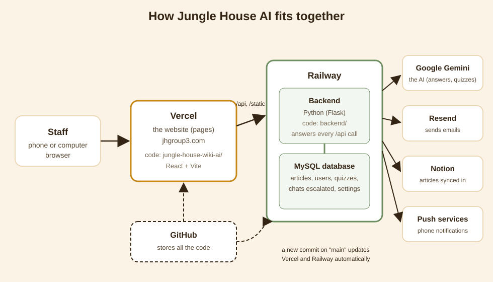

| Piece | What it does (in plain words) | Where it runs | Code folder |
|---|---|---|---|
| **Website** | The pages staff see: AI Chat, Knowledge Base, Quiz and so on. | **Vercel** | `jungle-house-wiki-ai/` |
| **Backend** | The "brain" behind the pages. It checks logins, finds articles, asks the AI and saves everything. | **Railway** | `backend/` |
| **Database** | Stores all articles, users, quizzes, escalations and settings. | **Railway** (MySQL) | table definitions in `backend/migrations/` |
| **AI** | Writes chat answers and quiz questions, and understands what questions mean. | **Google Gemini** (chosen in the website's AI Model Settings) | |
| **Email** | Sends "forgot password" and registration emails. | **Resend** | |
| **Notion** | The company's Notion pages can be copied into the Knowledge Base. | **Notion** | |
| **Code store** | Keeps every version of the code. | **GitHub** | the whole folder |

**How updates reach the live site:** when a developer saves a change to the `main` branch on GitHub, Vercel and Railway normally rebuild the live site by themselves within a few minutes. Nobody has to upload files by hand.

### Handover checklist

The student team fills in the left columns before the handover meeting. The client fills in the right column on the day.

| Service | Current owner (student team) | Login / plan today | New owner (Jungle House) | Done? |
|---|---|---|---|---|
| GitHub repository `Group3_Jungle-House` | JonathanSong02 | [fill in] | [company GitHub account] | ☐ |
| Railway project (backend + MySQL) | [fill in] | [fill in] | [company Railway workspace] | ☐ |
| Vercel project (website) | [fill in] | [fill in] | [company Vercel team, Pro plan] | ☐ |
| Domain `jhgroup3.com` | [fill in] | registrar: [fill in] | [company] | ☐ |
| Google Gemini API key | [fill in] | [fill in] | [company Google account] | ☐ |
| Resend (email) | [fill in] | [fill in] | [company Resend account] | ☐ |
| Notion connection | [fill in] | [fill in] | [company Notion workspace] | ☐ |
| Manager accounts on the website | [list emails] | | passwords changed | ☐ |

---

# Part 1: Take over the live website

**Goal:** at the end of Part 1, the live website, its database (all 662+ articles, users and quizzes) and every outside service belong to Jungle House. Every password and key has been changed, so the student team no longer has access.

**Time needed:** about half a day, best done together with one student team member in a video call or meeting.

**The safest order:** do the steps in order. Don't delete anything from the student accounts until Step 7 says everything works.

## Step 1: Create your company accounts

Use **one company email address** for all of them, for example `it@junglehouse.com`, not a personal email, so access doesn't leave with a staff member. Turn on **two-step login (2FA)** wherever it is offered.

### 1.1 GitHub (code store)

1. Go to <https://github.com/signup> and create an account with the company email.
2. Verify the email address (GitHub sends a code).
3. Write down the **username** you chose. The student team needs it in Step 2.

The project's code page today looks like this:

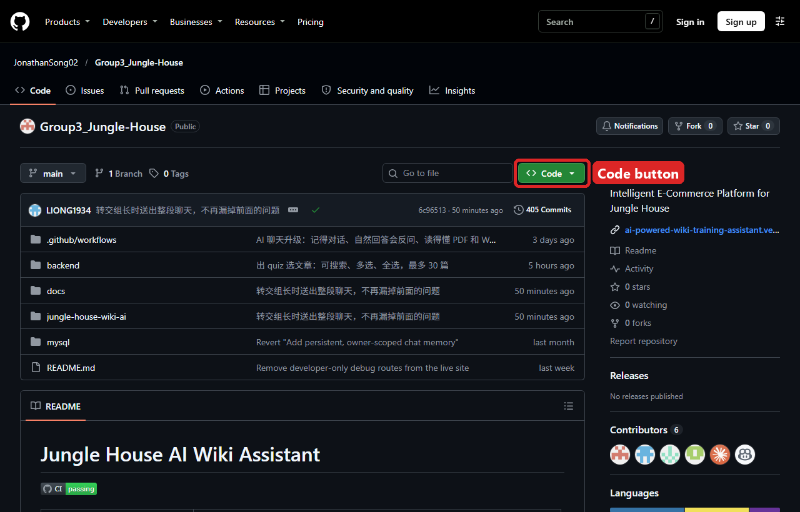

### 1.2 Railway (backend and database)

1. Go to <https://railway.com> and click **Sign in**. Choose **Continue with GitHub** and use the company GitHub account from 1.1. One login is easier to manage.
2. Choose a paid plan (**Hobby** or **Pro**): click your workspace name → **Settings** → **Plans**. **A paid plan is required.** Railway only lets a project move between workspaces that both have an active Hobby or Pro plan. Prices: <https://railway.com/pricing>.

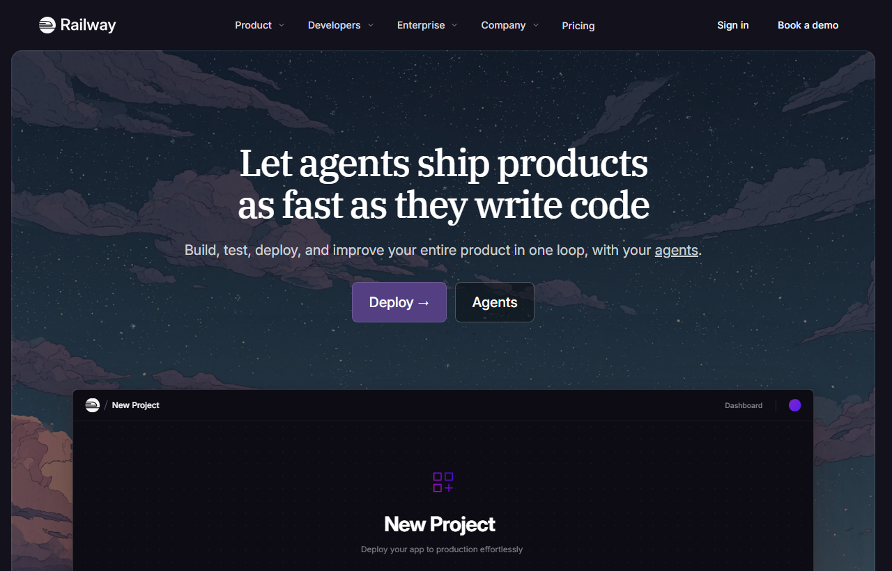

### 1.3 Vercel (website)

1. Go to <https://vercel.com/signup>.
2. Click **Continue with GitHub** and use the company GitHub account.

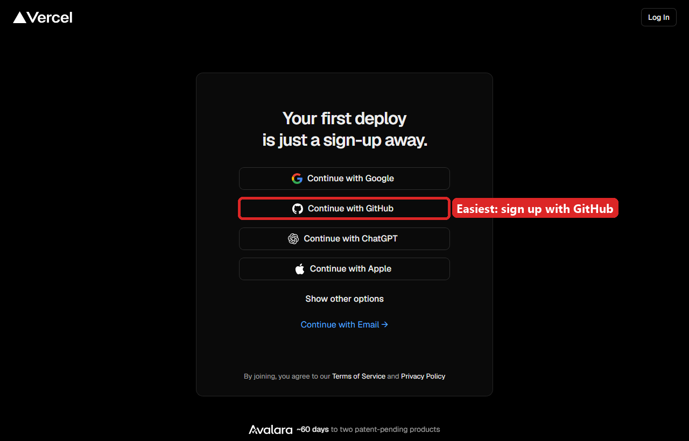

3. **Choose the Pro plan.** Vercel's free **Hobby** plan is only for **personal, non-commercial** use. Jungle House is a business, so its website must be on **Pro** (or Enterprise). Prices: <https://vercel.com/pricing>.
4. Create a **team** for the company, for example "Jungle House". The project will be moved into this team.

### 1.4 Google AI Studio (the AI key)

1. Go to <https://aistudio.google.com/app/apikey> and sign in with the company Google account.

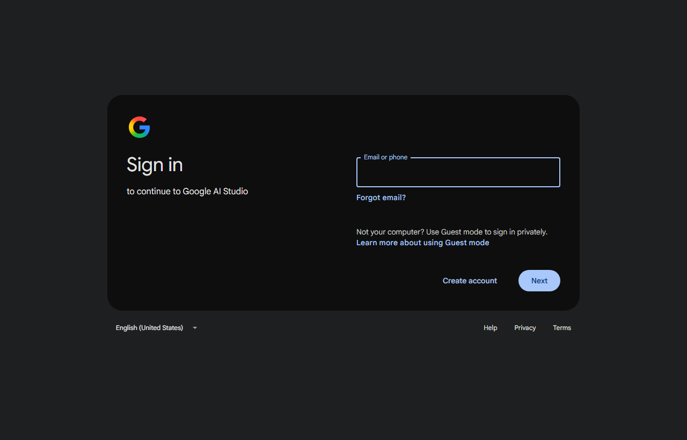

2. You'll create the key itself in [Step 6.2](#62-the-ai-key-google-gemini).
3. Set up billing for the Google Cloud project that the key belongs to, so the AI keeps working past the free limits. AI Studio shows a "Set up billing" link next to the key.

### 1.5 Resend (emails)

1. Go to <https://resend.com> and click **Get started**. Sign up with the company email.

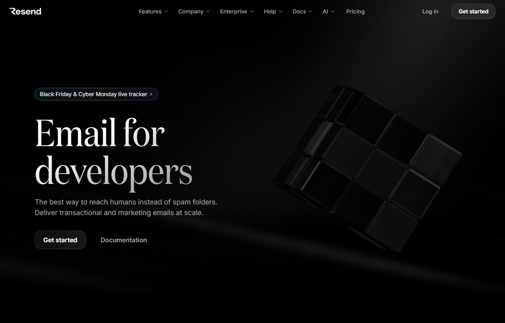

### 1.6 Notion

Jungle House already has a Notion workspace. Make sure the person doing the handover is an **owner or admin** of that workspace. That role is needed in [Step 6.4](#64-notion-connection).

---

## Step 2: Move the code (GitHub)

The code lives in the repository `JonathanSong02/Group3_Jungle-House`. Only its owner (**JonathanSong02**) can move it.

**What the current owner does:**

1. Open <https://github.com/JonathanSong02/Group3_Jungle-House> → **Settings** (top right of the repository) → scroll to the bottom, **Danger Zone** → **Transfer**.
2. Under "New owner", type the company GitHub username from Step 1.1, then type the repository name to confirm.
3. Click **I understand, transfer this repository**.

**What you do:**

4. Open the email from GitHub and accept the transfer.
5. **You should see** the repository at `https://github.com/<company-username>/Group3_Jungle-House`, with all its history: over 400 saved versions ("commits").

> Moving a repository keeps every file, all history and the automatic checks. The old address redirects to the new one.
> Official help: <https://docs.github.com/en/repositories/creating-and-managing-repositories/transferring-a-repository>

**Should the repository be private?** The repository is **public** today: anyone can read the code, though not your passwords or data, which are never in the code. After the transfer, you can make it private in **Settings → General → Danger Zone → Change visibility**. If you do, do Step 4 first, so Vercel is already connected under your account.

---

## Step 3: Move the backend and database (Railway)

The Railway project holds two parts: the **backend** service and the **MySQL** database. Moving the whole project keeps **all data, settings ("variables") and the web address** of the backend.

**What the current owner does:**

1. Open the project on <https://railway.com/dashboard>.
2. Railway moves projects between **workspaces**. Either:
   - **a)** invite the company account into the student workspace as a member, then the student opens the project → **Settings** → **Transfer Project** and picks the company workspace; or
   - **b)** add the company account as a **member of the project**, then, in the project's member list, click the **⋯** next to the company account and choose **Transfer Ownership**.

   Both source and destination need an active Hobby or Pro plan, and the person starting it must be an **Admin** of the project. Official help: <https://docs.railway.com/projects>.

**What you check afterwards:**

3. In your Railway dashboard, open the project. **You should see** two boxes: the backend (named after the GitHub repository) and **MySQL**.
4. Click the backend box → **Settings** → **Networking** (or **Domains**). Note its public address. Today it is `group3jungle-house-production.up.railway.app`.
5. Open `https://<that address>/health` in a browser. **You should see** a short text reply that starts with `{"status": "ok"`. An error page means the backend is not running: check the **Deployments** tab and see Step 16.
6. Click the backend box → **Settings** → **Source**. If it shows the old GitHub owner, click **Disconnect** and connect it again to `<company-username>/Group3_Jungle-House`, branch `main`. Then a code change rebuilds the backend automatically.

> **Billing:** from now on, Railway bills your workspace for the time the backend and database run.
> **Uploaded files:** article pictures, PDFs and chat photos uploaded by staff are saved by the backend. If the backend has a **Volume** in Railway (a box with a disk icon attached to it), it moves with the project. If you're not sure, ask the student team to show you before the handover.

---

## Step 4: Move the website (Vercel)

**What the current owner does:**

1. In Vercel, open the project → **Settings** → **General** (or **Advanced**) → **Transfer Project** → choose the company team from Step 1.3.
   - Requirement: the student must **own** the team the project is in, and be a **member** of the company team. Add them to your team for the day, and remove them afterwards.
   - Official help: <https://vercel.com/docs/projects/transferring-projects>.
2. If the domain `jhgroup3.com` is attached to the project, follow [Step 5](#step-5-the-web-address-jhgroup3com) as well.

**What you check afterwards:**

3. Open the project in your Vercel team → **Settings** → **Git**. If it isn't connected to `<company-username>/Group3_Jungle-House`, click **Connect Git Repository** and choose it. The **Root Directory** must be `jungle-house-wiki-ai`.
4. Integrations attached to the project don't move by themselves. Vercel asks you to add them again after a transfer. Check **Settings → Integrations**.
5. **Important file: `jungle-house-wiki-ai/vercel.json`.** It tells the website where the backend is. Today it sends `/api/...` and `/static/...` to `https://group3jungle-house-production.up.railway.app`. If the backend address from Step 3.4 is **different**, a developer must change both lines in this file and save the change to GitHub (see [Step 15](#step-15-make-a-change-and-publish-it)).

---

## Step 5: The web address (jhgroup3.com)

The address `jhgroup3.com` was bought from a **domain registrar**, the company where it was bought: **[student team: fill in the registrar and who owns it]**.

- **If it was bought inside Vercel:** in Vercel, remove the domain from the project, then use **Domains** → **Move** to move it to the company team, and add it to the project again.
- **If it was bought somewhere else** (for example Namecheap or GoDaddy): ask the owner to start a **domain transfer** to a registrar account owned by Jungle House. Or ask them to make the company account the owner. The registrar's help pages explain the steps, and an "authorisation code" is usually needed.
- **Your own domain instead?** You can use a company domain, for example `ai.junglehouse.com`. Add it in Vercel → project → **Settings → Domains** and follow the DNS instructions Vercel shows. Then update `FRONTEND_URL` in Railway ([Appendix A](#appendix-a-every-setting-explained)).

**You should see:** `https://jhgroup3.com/login` (or your new address) shows the Jungle House login page:

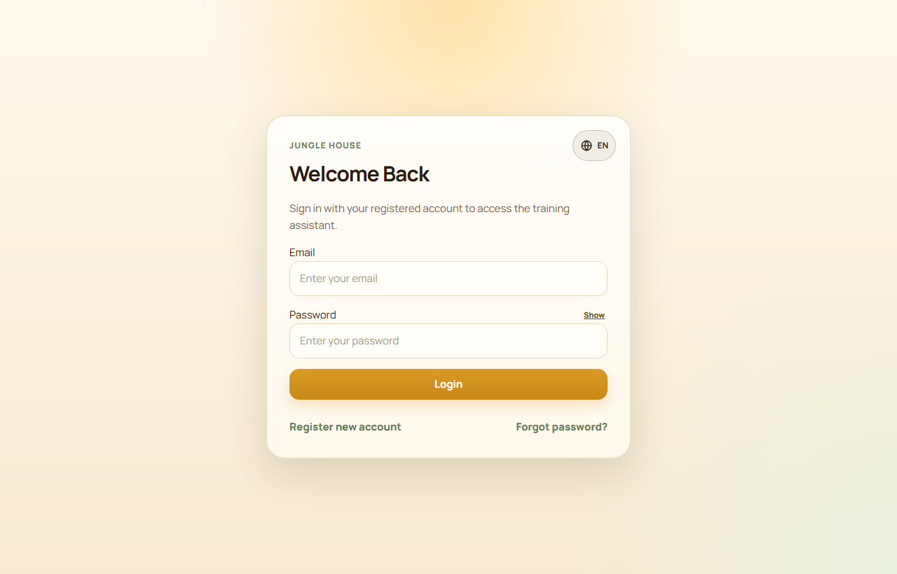

---

## Step 6: Replace every key and password

Until this step, the student team still knows the secret keys. Replace all of them.

### 6.1 Where settings live: Railway "Variables"

The backend's secret settings are kept in Railway, not in the code:

1. Railway → your project → click the **backend** box → **Variables** tab.
2. To change one: click it, type the new value, save. Railway restarts the backend automatically, which takes 1–3 minutes.

**How to make a strong random value:** open **PowerShell** on any Windows computer (press the Windows key, type `powershell`, press Enter), paste this line and press Enter:

```powershell
-join ((48..57) + (65..90) + (97..122) | Get-Random -Count 48 | ForEach-Object {[char]$_})
```

It prints 48 random letters and numbers. Copy them into the variable. Make a new one for each secret.

Change these now:

| Variable | What it is | What to do |
|---|---|---|
| `FLASK_SECRET_KEY` | Protects the login sessions. | Replace with a new random value (at least 32 characters). Everyone is logged out once, which is normal. |
| `AI_KEY_ENCRYPTION_SECRET` | Locks the AI key stored in the database. | Replace with a new random value, **then** re-enter the AI key in 6.2. The old stored key can't be unlocked with the new secret. |
| `RESEND_API_KEY` | Lets the system send emails. | Replace in 6.3. |
| `NOTION_OAUTH_CLIENT_ID`, `NOTION_OAUTH_CLIENT_SECRET` | The Notion connection (only if they are set here). | Replace in 6.4, or delete them if you enter them in the website instead. |
| `MYSQL*` / `DB_*` | Database connection. | **Don't change by hand.** Railway fills them in from the MySQL box. To change the database password, use the MySQL box's own settings. |

Every variable is explained in [Appendix A](#appendix-a-every-setting-explained).

### 6.2 The AI key (Google Gemini)

1. Go to <https://aistudio.google.com/app/apikey> → **Create API key** → choose (or create) a Google Cloud project for Jungle House → copy the key. It starts with `AIza`.
2. Log in to the Jungle House website as a **manager**.
3. Open **AI Model Settings** in the left menu.
4. Choose provider **Gemini**, paste the key into the key box, pick the model marked **Recommended** in the model list, and click **Test**.
5. **You should see** a success message. Only then can you click **Save**: the page won't save a key that failed the test.
6. In Google AI Studio, **delete** the old key the student team created, if it was in your Google account.

> Meaning-based search ("make ice" finds "Ice machine") uses the same Gemini key. If you pick another AI provider (OpenAI, DeepSeek or Claude), chat still works, but search only matches words.

### 6.3 Email (Resend)

1. In Resend → **Domains** → **Add Domain** → enter the domain you want emails to come from, for example `junglehouse.com`.
2. Resend shows a few **DNS records**. Give them to whoever manages that domain to add, then click **Verify** in Resend. This can take up to a day.
3. Resend → **API Keys** → **Create API Key** (permission: "Sending access") → copy it.
4. In Railway Variables, set:
   - `RESEND_API_KEY` = the key;
   - `RESEND_FROM_EMAIL` = for example `no-reply@junglehouse.com` (must be on the verified domain);
   - `RESEND_FROM_NAME` = for example `Jungle House AI Wiki`.
5. **Check:** on the login page, click **Forgot password?** and enter a manager email. **You should receive** the reset email within a minute.

### 6.4 Notion connection

The website copies Notion pages into the Knowledge Base through a Notion "public integration".

1. Go to <https://www.notion.so/profile/integrations> → **New integration** → type **Public**, name "Jungle House AI", workspace = Jungle House.
2. In the integration's **OAuth** settings, add this **Redirect URI** exactly (use the backend address from Step 3.4):
   `https://group3jungle-house-production.up.railway.app/api/notion-sync/oauth/callback`
3. Copy the **OAuth client ID** and **OAuth client secret**.
4. Log in to the website as a **manager** → **Notion Sync** → open the Notion app (OAuth) settings → paste the client ID and secret → save → click **Connect** and allow access to the pages staff should see.
5. **Check:** in **Notion Sync**, click **Check for updates**. **You should see** the job finish and any changed pages listed under pending updates.

### 6.5 Website accounts

1. Log in as a manager → **User Management**.
2. **Deactivate** every account that belongs to a student team member and is no longer needed.
3. Every manager should change their password: click your name (bottom left) → **Profile** → **Change Password**. A password needs 8+ characters, an uppercase letter and a number.
4. **Who can register?** New staff can only register with email addresses from the domains in the Railway variable `ALLOWED_REGISTRATION_DOMAINS`, today `junglehouse.com`. Separate several domains with commas, for example `junglehouse.com,junglehouse.my`. A manager still has to approve every new registration.

---

## Step 7: Check that everything works

Do these on a phone **and** on a computer. Tick each one.

| # | Try this | You should see |
|---|---|---|
| 1 | Open `https://jhgroup3.com/login` | The login page (picture in Step 5) |
| 2 | Log in as a manager | The AI Chat page |
| 3 | Ask the AI Chat "How do I open the shop?" | An answer within about 10 seconds, with **Show more details** and related articles |
| 4 | Ask something unclear, like "opening" | A question back with numbered options 1, 2, 3 |
| 5 | Open **Knowledge Base** and open any article | The article with its pictures |
| 6 | **AI Model Settings** → **Test** | Success |
| 7 | **Quiz Management** → **AI Generate** → 5 questions → Generate | 5 editable questions within a minute |
| 8 | **Notion Sync** → **Check for updates** | The check finishes |
| 9 | **Forgot password?** on the login page | The reset email arrives |
| 10 | **Profile** → **Phone notifications** → **Turn on**, ask a question, lock the phone | "AI answer is ready" on the phone. On iPhone, first add the site to the Home Screen: Safari **Share** → **Add to Home Screen**, and open it from there. |
| 11 | `https://<backend address>/health` | Text starting with `{"status": "ok"` |
| 12 | GitHub → repository → **Actions** tab | The latest run has a green tick ✓ |

When all 12 work, the student team can be removed from GitHub, Railway, Vercel, Resend and Notion.

---

## Step 8: Running the system day to day

**Monthly costs (check current prices yourself):**
- Railway: usage of the backend and database. <https://railway.com/pricing>
- Vercel: the Pro plan. <https://vercel.com/pricing>
- Google Gemini: you pay per use. AI Studio shows usage and limits. <https://ai.google.dev/pricing>
- Resend: free up to its monthly email limit. <https://resend.com/pricing>
- The domain: once a year at the registrar.

**Backups:** in Railway → **MySQL** box, check the **Backups** tab, if your plan includes it. Also make a copy yourself once a month with MySQL Workbench: [Step 11, option A](#option-a-copy-the-live-data-recommended) shows how to export.

**If something stops working:**

| What staff see | Most likely reason | What to do |
|---|---|---|
| "AI chat is currently unavailable" | The AI key ran out of credit or quota, or was deleted | AI Model Settings → **Test**. If it fails, check billing in Google AI Studio, or create a new key (6.2). |
| The whole site shows errors, or nobody can log in | The backend or database stopped | Railway → backend → **Deployments**: the newest must say "Active"/"Success". Open `/health`. Click **Redeploy** on the last good deployment if needed. |
| Forgot-password emails don't arrive | Resend key, or domain not verified | Resend → **Logs**, and check 6.3. |
| Notion updates stop appearing | The Notion connection expired | Notion Sync → **Connect** again (6.4). |
| A new version broke something | A code change | Vercel or Railway → **Deployments** → **⋯** on the previous good one → **Promote to Production** (Vercel) or **Redeploy** (Railway). Then ask a developer to fix the code. |

**Useful built-in tools for managers:**
- **AI Model Settings → Check search accuracy:** tests whether the AI can find the right sentence for every article, and lists duplicate articles to clean up.
- **Analytics** and **Security / Monitoring:** usage and login history.
- **Escalation:** questions the AI could not answer. A team lead answers them, and approved answers are used by the AI next time.

---

# Part 2: Install the system on a computer

**Goal:** a developer runs a **private copy** of the system on a Windows 10/11 computer, changes it safely, and then publishes the change to the live site.

**Time needed:** 1–2 hours the first time, mostly downloads.

**You need:** Windows 10 or 11, at least 8 GB of memory, about 10 GB of free disk space, and a company GitHub account with access to the repository.

> **PowerShell:** many steps ask you to type commands in **PowerShell**. Open it by pressing the Windows key, typing `powershell` and pressing Enter. Paste a command with **right-click** and press **Enter**. Lines starting with `#` are explanations; you don't need to type them.

## Step 9: Install the tools

Install these five programs in this order. Restart the computer once at the end.

### 9.1 Python 3.12 (the backend's language)

> **Use version 3.12, not the newest.** The newest Python (3.14) can't install one of the packages this system needs (`numpy` at the version the system uses). The automatic tests on GitHub also use 3.12.

1. Open <https://www.python.org/downloads/release/python-31210/> and scroll down to **Files**.
2. Click **Windows installer (64-bit)**:

   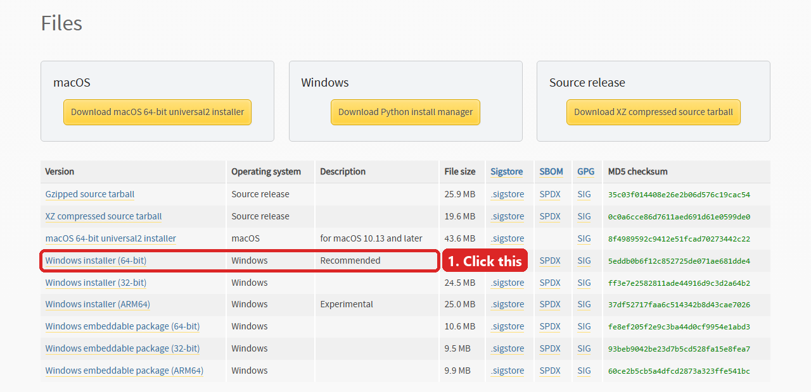

3. Run the downloaded file. On the first screen, **tick "Add python.exe to PATH"** at the bottom, then click **Install Now**. This tick is the most commonly missed step.
4. **Check:** open a **new** PowerShell window and type:

   ```powershell
   py -3.12 --version
   ```

   **You should see:** `Python 3.12.10`

### 9.2 Node.js (the website's tools)

1. Open <https://nodejs.org/en/download> and click **Windows Installer (.msi)**. Use the version marked **LTS**.

   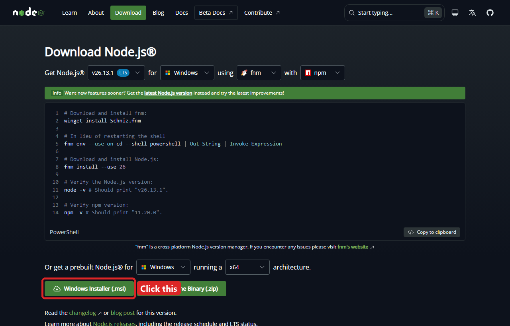

2. Run it and keep clicking **Next** with the default choices.
3. **Check** in a new PowerShell window:

   ```powershell
   node --version
   npm --version
   ```

   **You should see** two version numbers, for example `v26.13.1` and `11.x`. Any LTS version from 22 up works.

### 9.3 GitHub Desktop (downloads and saves code without typing commands)

1. Open <https://desktop.github.com/download/> and click **Download for Windows**.

   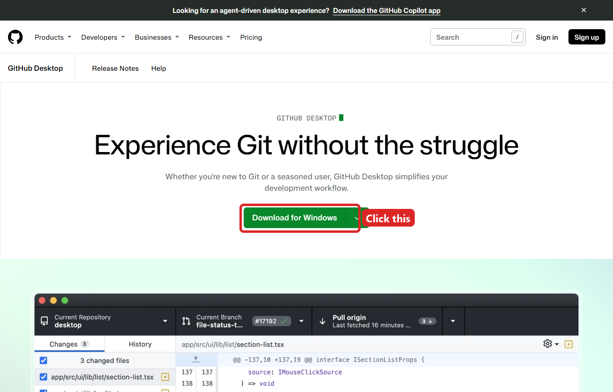

2. Install it, open it and sign in with the company GitHub account.

### 9.4 MySQL 8 and MySQL Workbench (the local database)

1. Open <https://dev.mysql.com/downloads/installer/> and download the **bigger** installer, about 566 MB. It works offline and includes Workbench.

   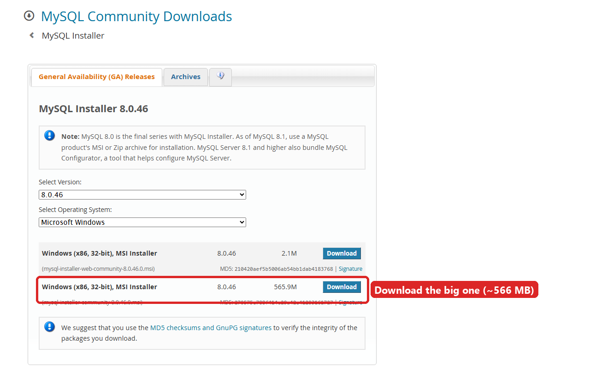

2. On the next page, click **No thanks, just start my download**.
3. Run the installer:
   - Choose **Custom**, then add **MySQL Server 8.0** and **MySQL Workbench 8.0**.
   - Click **Next** / **Execute** until it asks for the **root password**. Choose one and **write it down**. You need it in Step 12.
   - Keep everything else as it is, for example port **3306** and "Start the MySQL Server at System Startup".
4. **Check:** open **MySQL Workbench**, click the "Local instance MySQL80" box and enter the root password. **You should see** the Workbench editor.

### 9.5 (Optional) Visual Studio Code (to edit code)

Download it from <https://code.visualstudio.com/>. Any editor works.

---

## Step 10: Download the code

1. Open **GitHub Desktop** → **File** → **Clone repository** → **GitHub.com** tab → choose `<company-username>/Group3_Jungle-House`.
2. **Local path:** use a short path without spaces, for example `C:\Projects\Group3_Jungle-House`.
3. Click **Clone**. **You should see** the repository open in GitHub Desktop, with "Current branch: main".

> **Without GitHub Desktop:** on the repository page, click the green **Code** button (see the picture in Step 1.1) → **Download ZIP**, then unzip it to `C:\Projects\Group3_Jungle-House`. You can't publish changes from a ZIP copy, though.

The folder now contains:

```
Group3_Jungle-House\
├─ backend\                ← the backend (Python)
│  ├─ src\                 ← backend code; app.py is the main file
│  ├─ migrations\          ← database table definitions
│  ├─ tools\               ← database tools (migrate.py)
│  ├─ requirements.txt     ← list of Python packages
│  └─ static\              ← pictures used by articles
├─ jungle-house-wiki-ai\   ← the website (React)
│  ├─ src\                 ← website code
│  ├─ package.json         ← list of website packages
│  └─ vercel.json          ← tells Vercel where the backend is
├─ docs\                   ← documentation (this guide is in docs\handover\)
└─ README.md               ← how the automatic tests work
```

---

## Step 11: Set up a local database

Choose **one** option.

### Option A: Copy the live data (recommended)

You get a private copy of all articles and accounts, so you can log in with the same manager account. Changes on your computer never touch the live site.

**A1. Find the live database's connection details.** In Railway → project → **MySQL** box → **Variables** (or **Connect**), note the **public** connection values:

| Railway shows | Means |
|---|---|
| `MYSQLHOST` in the **public** URL, like `xxxx.proxy.rlwy.net` | Host |
| the port in the public URL, like `12345` | Port (**not** 3306) |
| `MYSQLUSER` | User, usually `root` |
| `MYSQLPASSWORD` | Password |
| `MYSQLDATABASE` | Database name, usually `railway` |

> If only an internal address ending in `.railway.internal` is shown, enable the **TCP Proxy** in the MySQL box → **Settings** → **Networking**.

**A2. Export from the live database.**

1. MySQL Workbench → **Database** menu → **Manage Connections** → **New** → Connection Name `Railway (live)`.
2. Fill in the Host, Port and Username from A1. Click **Store in Vault…** and enter the password. Click **Test Connection**. **You should see** "Successfully made the MySQL connection". Close.
3. Open the connection. Then: **Server** menu → **Data Export** → tick the database (`railway`) → **Export to Self-Contained File** → choose `C:\Projects\jungle_house_backup.sql` → tick **Include Create Schema** → **Start Export**.
4. **You should see** "Export of … has finished".

**A3. Import into your local database.**

1. Open the **Local instance MySQL80** connection.
2. **Server** menu → **Data Import** → **Import from Self-Contained File** → choose the `.sql` file.
3. **Default Target Schema** → **New…** → type `jungle_house` → OK.
4. **Start Import**. **You should see** "Import of … has finished". The left panel, after **Refresh**, shows `jungle_house` with about 40 tables.

> Keep this backup file safe. It contains staff names and emails. Delete it when you no longer need it.

### Option B: Start with an empty database

Use this only when you want a clean system with no articles.

1. In MySQL Workbench (local connection), run:

   ```sql
   CREATE DATABASE jungle_house CHARACTER SET utf8mb4;
   ```

2. Do **Step 12.1 and 12.2** first, so Python and the settings file are ready. Then, in PowerShell, load the settings and build all tables:

   ```powershell
   cd C:\Projects\Group3_Jungle-House\backend\src
   .\venv\Scripts\Activate.ps1
   . .\.env.local.ps1
   cd C:\Projects\Group3_Jungle-House
   python backend\tools\migrate.py apply
   ```

   **You should see** "Applied N migration(s)".
3. Add the user roles and your first manager. First create a password hash. Replace `YourPassw0rd` with a real password that has 8+ characters, an uppercase letter and a number:

   ```powershell
   python -c "from werkzeug.security import generate_password_hash as g; print(g('YourPassw0rd'))"
   ```

   Copy the long line it prints. It starts with `scrypt:` or `pbkdf2:`. Then run this in Workbench, with your own name, email and the copied line:

   ```sql
   USE jungle_house;
   INSERT INTO roles (role_name) VALUES ('manager'), ('teamlead'), ('staff'), ('admin');
   INSERT INTO users (full_name, email, password_hash, role_id, status)
   VALUES ('First Manager', 'manager@junglehouse.com', 'PASTE-THE-LONG-LINE-HERE',
           (SELECT role_id FROM roles WHERE role_name = 'manager'), 'active');
   ```

---

## Step 12: Start the backend

### 12.1 Create the Python environment and install packages (one time)

In PowerShell:

```powershell
cd C:\Projects\Group3_Jungle-House\backend\src
py -3.12 -m venv venv
# If the next line shows "running scripts is disabled", run this first:
#   Set-ExecutionPolicy -Scope CurrentUser -ExecutionPolicy RemoteSigned
.\venv\Scripts\Activate.ps1
```

**You should see** `(venv)` at the start of the line. That means you are inside the project's private Python.

Then install the packages. Choose one:

```powershell
# FULL: same as the live site, including photo search (downloads about 3 GB, 10-30 minutes)
pip install -r ..\requirements.txt

# LIGHT: everything except photo search (much faster; recommended for most changes)
pip install -r ..\requirements-ci.txt -c ..\requirements.txt
```

**You should see** "Successfully installed …" at the end. Yellow "notice" lines about a newer pip are fine.

### 12.2 Create your local settings file (one time)

The backend reads its settings when it starts. Create a file that sets them in PowerShell:

1. In `C:\Projects\Group3_Jungle-House\backend\src`, create a new text file named exactly **`.env.local.ps1`**. In VS Code: File → New File → save it with that name. Git is set up to never upload files with this name.
2. Paste this, then change the values in `<...>`:

```powershell
# Local settings for Jungle House AI. Never upload or share this file.
$env:MYSQL_HOST = "127.0.0.1"
$env:MYSQL_PORT = "3306"
$env:MYSQL_USER = "root"
$env:MYSQL_PASSWORD = "<your MySQL root password from Step 9.4>"
$env:MYSQL_DATABASE = "jungle_house"

# Any random text of 32+ characters (see Step 6.1 for a generator). Local only.
$env:FLASK_SECRET_KEY = "<48 random letters and numbers>"

# With Option A (copy of live data): use the SAME value as Railway's
# AI_KEY_ENCRYPTION_SECRET, so the saved AI key works. Otherwise any random
# text, and enter an AI key again in AI Model Settings.
$env:AI_KEY_ENCRYPTION_SECRET = "<value>"

$env:FRONTEND_URL = "http://localhost:5173"
$env:FLASK_DEBUG = "1"

# Keep background jobs off on your computer (they talk to Notion / Google).
$env:NOTION_AUTO_SYNC_ENABLED = "false"
$env:DOCUMENT_TEXT_BACKFILL = "false"
$env:IMAGE_INDEX_WORKER_ENABLED = "false"

# Optional: emails (leave out to skip sending emails locally)
# $env:RESEND_API_KEY = "<key>"
# $env:RESEND_FROM_EMAIL = "no-reply@junglehouse.com"
```

> **Why not a `.env` file?** The backend checks `FLASK_SECRET_KEY` the moment it starts, before a `.env` file would be read. So it would stop with "Configure a stable FLASK_SECRET_KEY". Loading the settings into PowerShell first avoids that.

### 12.3 Start it (every time)

```powershell
cd C:\Projects\Group3_Jungle-House\backend\src
.\venv\Scripts\Activate.ps1
. .\.env.local.ps1        # note the dot and space at the start
python app.py
```

**You should see** lines ending with something like:

```
 * Running on http://127.0.0.1:5000
```

Leave this window open: closing it stops the backend. **Check:** open <http://127.0.0.1:5000/health> in a browser. **You should see** text starting with `{"status": "ok"`.

---

## Step 13: Start the website

Open a **second** PowerShell window, so the backend keeps running in the first:

```powershell
cd C:\Projects\Group3_Jungle-House\jungle-house-wiki-ai
npm ci          # one time, and again whenever package.json changes (2-5 minutes)
npm run dev
```

**You should see:**

```
  VITE v8.x  ready in 2800 ms
  ➜  Local:   http://localhost:5173/
```

Open <http://localhost:5173>. **You should see** the same login page as the live site. Log in:
- **Option A:** with your normal manager account. It's a copy, so the same password works.
- **Option B:** with the manager you created.

The website automatically sends `/api` requests to the backend on port 5000 (set in `vite.config.js`), so nothing else needs configuring.

**To stop:** press `Ctrl + C` in each PowerShell window.

---

## Step 14: Run the automatic tests

The project has about 670 backend tests and 160 website tests. GitHub runs them automatically on every change (the **Actions** tab), but you can run them yourself before publishing:

```powershell
# Backend tests (no database needed)
cd C:\Projects\Group3_Jungle-House\backend\src
.\venv\Scripts\Activate.ps1
$env:FLASK_SECRET_KEY = "dummy-local-test-key-0123456789-0123456789"
$env:NOTION_AUTO_SYNC_ENABLED = "false"
python -m unittest discover -s . -p "test_*.py"
```

**You should see** at the end: `OK (skipped=3)`.

```powershell
# Website checks
cd C:\Projects\Group3_Jungle-House\jungle-house-wiki-ai
npm run lint
node --test "src/**/*.test.js"
npm run build
```

**You should see:**
- lint: "0 errors" (warnings are fine);
- tests: `ℹ fail 0`;
- build: `✓ built in …`.

> Known issue: three website tests (`EscalationContext`, `EscalationEvidence`, `StandardQuestionField`) sometimes fail with "Cannot read properties of null (reading 'useState')", even without any change. Run the tests again before assuming your change broke them.

More detail on the automatic checks: [README.md](../../README.md).

---

## Step 15: Make a change and publish it

1. Change the code in VS Code. Check it on <http://localhost:5173>.
2. Run the tests (Step 14).
3. In **GitHub Desktop**, your changed files are listed on the left. Write a short **Summary** of what you changed, for example "Fix spelling on login page". Click **Commit to main**, then **Push origin**.
4. On GitHub → **Actions** tab: wait for the green tick ✓, about 1–2 minutes. A red ✗ means a test failed: open it to see which one, and fix it.
5. Vercel and Railway rebuild the live site automatically, in 2–5 minutes. Watch it in their **Deployments** tabs.
6. Open the live site and check your change.

**Rules that keep the live site safe:**
- Make **small** changes, one at a time.
- Database changes: only **add** new tables or columns, never delete or rename existing ones. Add a new numbered file in `backend/migrations/`, as explained in [docs/database-migrations.md](../database-migrations.md).
- Never put passwords or keys in the code. They belong in Railway Variables (live) or `.env.local.ps1` (your computer).
- Every text staff can see must be added in three languages (English, 中文, Bahasa Melayu) in `jungle-house-wiki-ai/src/i18n/translations.js`.

---

## Step 16: Troubleshooting

| Problem | Fix |
|---|---|
| `py` or `python` is "not recognized" | Python was installed without "Add python.exe to PATH". Run the Python installer again → **Modify** → tick **Add Python to environment variables**. Or reinstall with the tick. Open a **new** PowerShell window afterwards. |
| `npm` is "not recognized" | Restart the computer after installing Node.js. |
| "running scripts is disabled on this system" | Run `Set-ExecutionPolicy -Scope CurrentUser -ExecutionPolicy RemoteSigned`, answer `Y`, then try again. |
| `pip install` fails on **numpy** | You are on Python 3.13 or 3.14. Delete the `venv` folder and do Step 12.1 again with `py -3.12`. |
| "Configure a stable FLASK_SECRET_KEY of at least 32 characters" | You forgot `. .\.env.local.ps1` before `python app.py`, or the value is shorter than 32 characters. |
| "Missing MySQL environment configuration" | Same as above: the settings file was not loaded in this window. |
| "Access denied for user 'root'" | Wrong `MYSQL_PASSWORD` in `.env.local.ps1`. |
| "Unknown database 'jungle_house'" | Step 11 wasn't finished, or the database has another name. Check the left panel in Workbench. |
| Login page loads but logging in does nothing / "Network Error" | The backend window isn't running, or is on another port. Check <http://127.0.0.1:5000/health>. |
| "Address already in use" / port 5000 or 5173 busy | Another copy is still running. Close the other PowerShell windows, or restart the computer. |
| AI Chat says "AI chat is currently unavailable" locally | No working AI key. Go to AI Model Settings and enter a key → Test → Save. |
| GitHub Actions shows a red ✗ | Open the run → click the red step → read the first error. Usually a test failed: run Step 14 locally and fix it. |
| The live site shows an old version after a push | Check Vercel / Railway → **Deployments** for a failed build, and read its log. |

---

## Appendix A: Every setting explained

These are set in **Railway → backend → Variables** (live) or in `.env.local.ps1` (your computer). The website (Vercel) needs **no** variables today: it reaches the backend through `vercel.json`.

| Variable | Needed? | What it does | Example / note |
|---|---|---|---|
| `FLASK_SECRET_KEY` | **Required** | Protects login sessions. | 32+ random characters. Changing it logs everyone out. |
| `AI_KEY_ENCRYPTION_SECRET` | **Required** | Locks the AI key saved in the database. | Random text. If changed, re-enter the AI key. |
| `MYSQLHOST`, `MYSQLPORT`, `MYSQLUSER`, `MYSQLPASSWORD`, `MYSQLDATABASE` | **Required** (live) | Database connection. | Filled in by Railway from the MySQL box. Locally, use `MYSQL_HOST` etc. as in Step 12.2. `DB_HOST` etc. also work. |
| `FRONTEND_URL` | **Required** (live) | The website's address, so the backend accepts its requests and puts the right links in emails. | `https://jhgroup3.com` |
| `RESEND_API_KEY` | For emails | Sends forgot-password and registration emails. | From Resend. |
| `RESEND_FROM_EMAIL` | For emails | Sender address. Must be on a domain verified in Resend. | `no-reply@junglehouse.com` |
| `RESEND_FROM_NAME` | Optional | Sender name. | Default "Jungle House AI Wiki". |
| `ALLOWED_REGISTRATION_DOMAINS` | Optional | Which email domains may register. | Default `junglehouse.com`. Separate several with commas. |
| `NOTION_OAUTH_CLIENT_ID`, `NOTION_OAUTH_CLIENT_SECRET` | Optional | Notion connection. Can be entered in the website's Notion Sync page instead. | From the Notion integration. |
| `NOTION_PUBLIC_BASE_URL` | Optional | The backend's public address used for the Notion redirect. | Normally detected automatically on Railway. |
| `NOTION_AUTO_SYNC_ENABLED` | Optional | Checks Notion for changes in the background. | `true` live, `false` locally. |
| `API_PUBLIC_URL` | Optional | The backend's public address, when it must be stated. | Usually not needed. |
| `SEMANTIC_SEARCH_ENABLED` | Optional | Meaning-based search on/off. | `0` turns it off (emergency only). |
| `SEMANTIC_SEARCH_SYNC` | Optional | Background update of meaning search. | `0` turns it off. |
| `DOCUMENT_TEXT_BACKFILL` | Optional | Reads text from PDF/Word attachments in the background. | `false` locally. |
| `IMAGE_INDEX_WORKER_ENABLED` | Optional | Background indexing for photo search. | `false` locally. |
| `DB_POOL_SIZE` | Optional | How many database connections are kept open for speed. | Default 10. `0` turns reuse off. |
| `SESSION_COOKIE_SECURE` | Optional | Login cookie only over https. | Automatic: on for Railway, off locally. |
| `FLASK_DEBUG` | Local only | Shows detailed errors. | `1` locally. **Never** on the live site. |
| `PORT`, `HOST` | Automatic | Where the backend listens. | Railway sets `PORT`. Default 5000 locally. |

Also inside the code (change only with a developer):
- `jungle-house-wiki-ai/vercel.json`: the backend address the website forwards to.
- `backend/railway.json`: how Railway starts the backend (gunicorn, 1 worker, 4 threads) and the health check path `/health`.

---

## Appendix B: Where things are in the code

| I want to change… | Look in |
|---|---|
| Any page's look or text | `jungle-house-wiki-ai/src/pages/` (one file per page) and `src/styles/` |
| Translations (English / 中文 / Malay) | `jungle-house-wiki-ai/src/i18n/translations.js` |
| The left menu | `jungle-house-wiki-ai/src/components/StaffLayout.jsx` |
| How the AI answers chat questions | `backend/src/app.py`, function `chat()`, and `ai_provider_service.py` |
| How articles are searched | `backend/src/app.py` (`build_ai_chat_context`) and `semantic_search.py` |
| AI quiz generation | `backend/src/app.py` (`ai_generate_quiz`) and `quiz_ai_batches.py` |
| Notion sync | `backend/src/notion_sync_service.py` |
| Phone notifications | `backend/src/web_push.py`, `jungle-house-wiki-ai/public/sw.js` |
| What the AI knows about using the system | `backend/src/system_knowledge.py` (`GUIDE_SECTIONS`) |
| Database tables | `backend/migrations/` and [docs/database-schema.md](../database-schema.md) |
| History of AI Chat changes | [docs/CHAT_MEMORY_ENHANCEMENTS.md](../CHAT_MEMORY_ENHANCEMENTS.md) |

---

*Prepared by Swinburne Group 3 in November 2026. Service screens and prices change over time. When a step here no longer matches the screen, follow the official help link in that step.*
